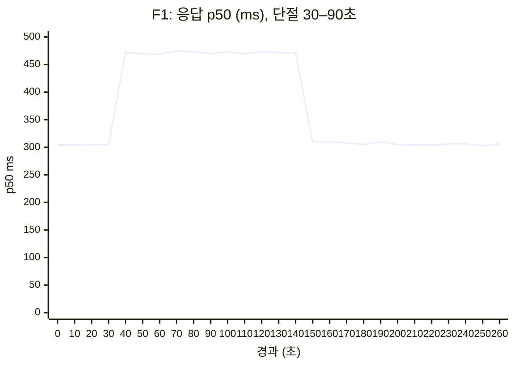
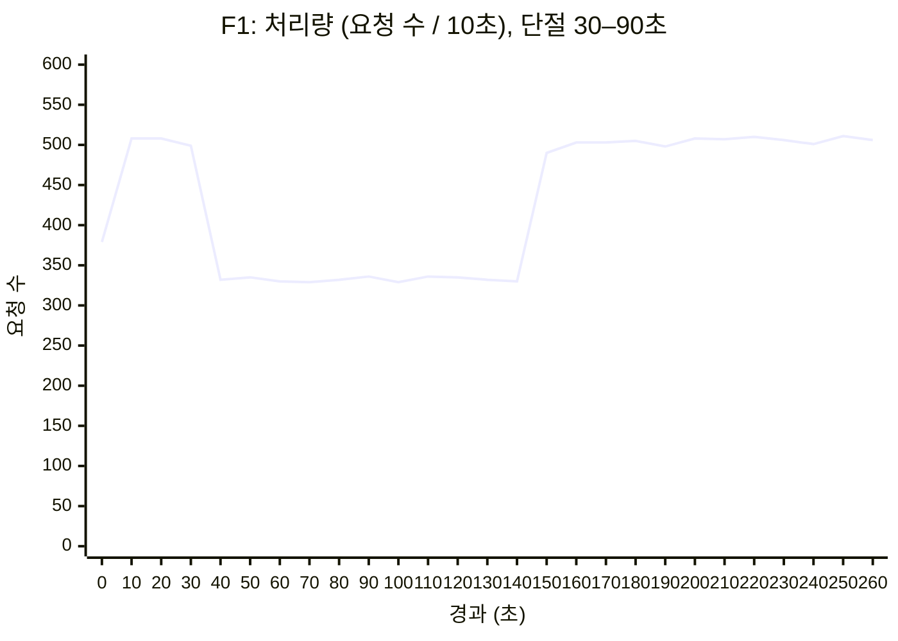
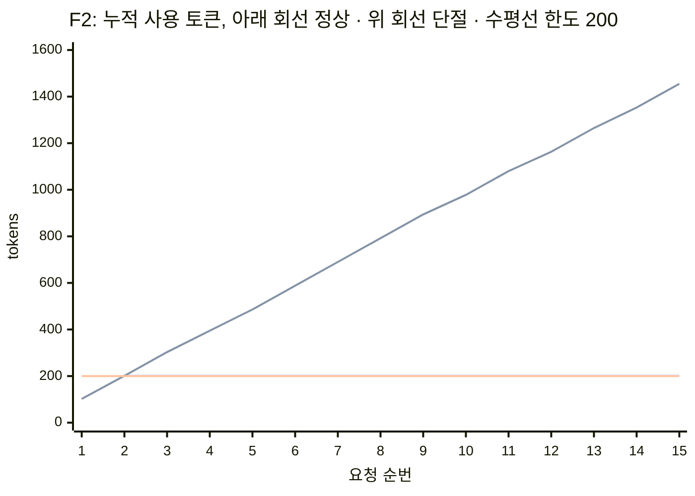
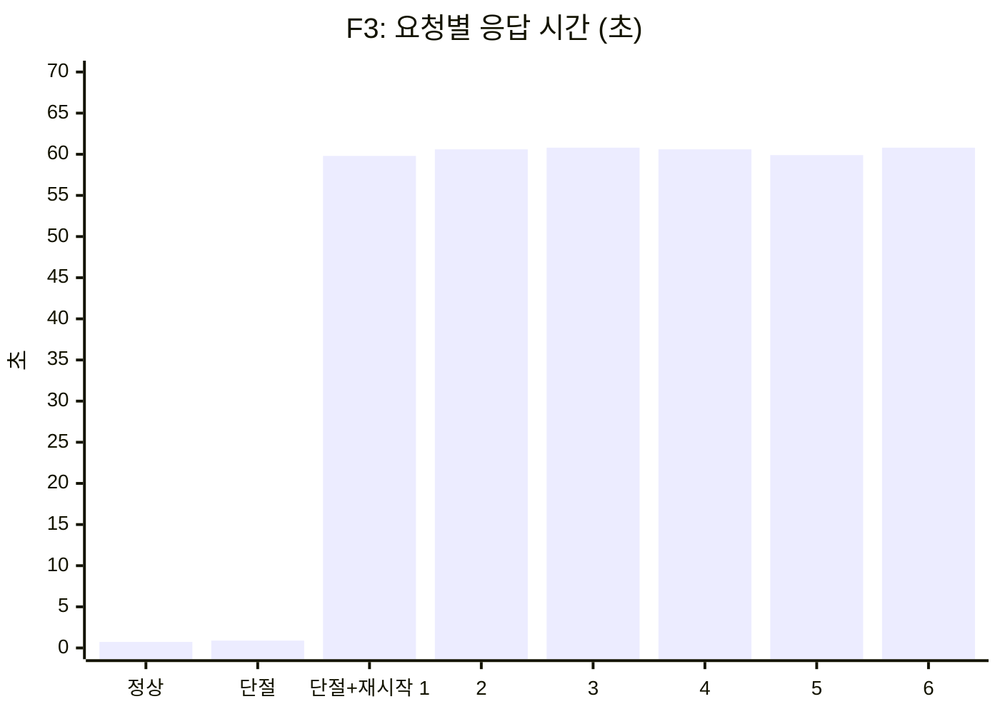
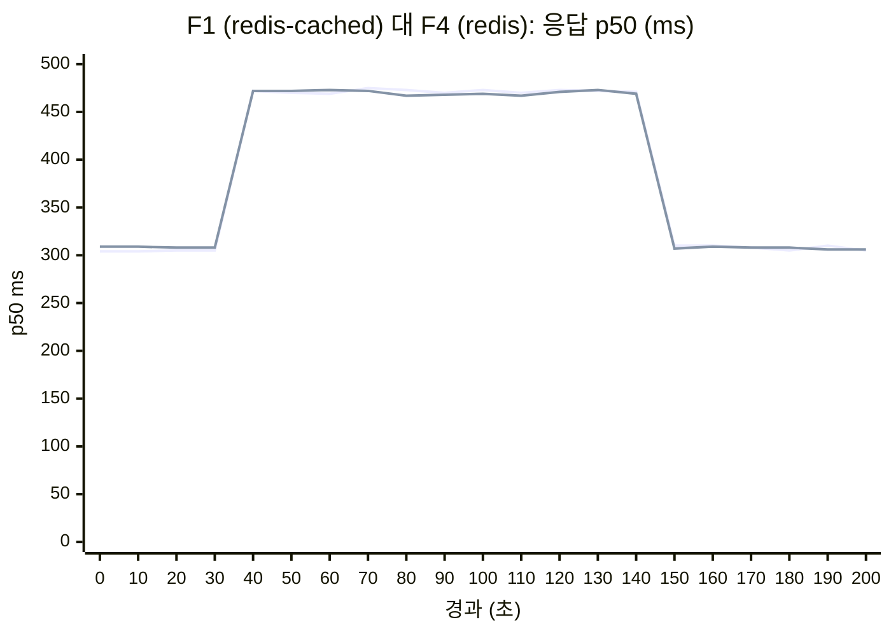
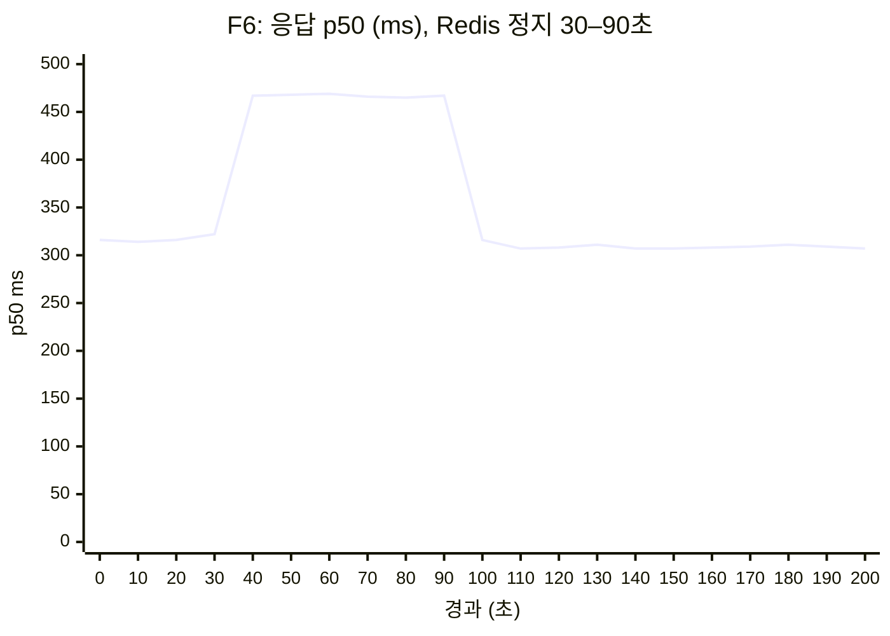

# 시나리오 32: 원격 region Redis 장애 시 MaaS 동작

**모듈:** 서빙 및 추론 > MaaS
**지원 단계:** GA (RHOAI 3.5, RHCL 1.4)
**관련 컴포넌트:** Limitador(`spec.storage`), External Redis, NetworkPolicy
**선행:** [시나리오 31](31-maas-remote-redis-latency.md)의 원격 Redis 구성

## 1. 목적

원격 Redis와의 회선 단절, Redis 재시작 시 MaaS 요청 처리와 쿼터 집행을 실측하여 다음에 답한다.

| 질문 | 시험 |
|---|---|
| 회선 장애가 서비스 장애로 이어지는가 | F1 |
| 회선 장애 중 쿼터가 집행되는가 | F2 |
| 회선 장애 중 Limitador를 재시작해도 되는가 | F3 |
| `redis-cached`가 `redis`보다 장애에 강한가 | F4 |
| Redis 재시작 시 사용량 카운터가 유지되는가 | F5 |
| Redis가 내려가면(연결 거부) 단절과 다르게 동작하는가 | F6 |

## 2. 배경

요청 1건은 Gateway에서 Limitador를 2회 호출한다(쿼터 검사, 사용량 보고). Limitador는 카운터를 원격 Redis에 저장한다.

| 설정 | 값 | 의미 |
|---|---|---|
| Limitador 호출 timeout | 100 ms | 초과 시 |
| `failureMode` | `allow` | **쿼터 검사 없이 요청 통과** |
| `redis-cached` (설계) | 메모리 카운터로 쿼터 검사 + 0.5초 주기 Redis 반영 | Redis 단절 시에도 쿼터 검사 가능할 것으로 기대 |
| `redis` | 요청마다 Redis 동기 접근 | 대조군 |

## 3. 환경

| 항목 | 값 |
|---|---|
| MaaS 클러스터 | sandbox1414, AWS `us-east-1`, RHOAI 3.5, RHCL 1.4 |
| 모델 | `maas-demo/maas-demo-model` (`Qwen2.5-1.5B-Instruct`), `g5.xlarge` × 1 |
| Limitador | replica 1, `redis-cached` (flush 500 ms) |
| Authorino | replica 3 |
| 원격 Redis | EC2 `us-east-2` (`m5.4xlarge`), Redis 7.2, 전용 8 core, `io-threads 4`, TLS, AOF `everysec`, RTT 약 13 ms |
| 원격 PostgreSQL | 같은 VM, 전용 8 core (maas-api DB) |
| 부하 | 동시 16, `max_tokens` 16, MaaS API key 20개, 정상 시 약 50 req/s |

## 4. 시험 방법

| # | 장애 | 재현 방법 | 시간 |
|---|---|---|---|
| F1 | 회선 단절 (`redis-cached`) | 부하 중 Limitador Pod egress를 NetworkPolicy로 DNS만 허용 | 정상 30초 → 단절 60초 → 복구 후 180초 |
| F2 | 단절 중 쿼터 | 한도 200 tok/2분 구독, `max_tokens` 64 요청 15회를 회선 정상·단절 상태에서 각각 수행 | — |
| F3 | 단절 중 Limitador 재시작 | 단절 상태에서 `oc delete pod -l app=limitador` | 단절 약 6분 |
| F4 | 회선 단절 (`redis`) | 저장 방식을 `redis`로 바꾸고 F1 반복 | 단절 60초 → 복구 후 120초 |
| F5 | 원격 Redis 재시작 | 원격 VM에서 `docker restart redis` (SIGTERM) | 정상 30초 → 재시작 → 120초 |
| F6 | 원격 Redis 정지 | 원격 VM에서 `docker stop redis` → 60초 후 `docker start redis` | 정상 30초 → 정지 60초 → 120초 |

측정 지표: client HTTP 코드·p50(10초 구간), Limitador `authorized_calls` 증가량(쿼터 검사 수행 여부), Redis 명령 증가량, 모델(vLLM) 처리 토큰 대비 Redis 카운터 증가량(사용량 기록률).

## 5. 결과

원본 데이터: `harness/results/scenario32/`

### 5.1 F1: 회선 단절 60초 (`redis-cached`)

> **회선이 끊겨도 요청은 계속 성공하지만, 단절 60초와 복구 후 약 50초 동안 쿼터 검사 없이 통과하며 응답이 약 165 ms 느려진다.**

| 구간 | 경과 | HTTP 200 비율 | p50 ms | 처리량 req/s | Limitador 쿼터 검사 | Redis 명령 |
|---|---|---|---|---|---|---|
| 정상 | 0–30초 | 99.7% | 305 | 50 | 수행 | 약 150/s |
| 단절 | 30–90초 | 99.8% | **471** | 33 | **중단 (0건)** | 0 |
| 복구 후 | 90–약 145초 | 99.7% | **471** | 33 | **중단 (0건)** | 0 |
| 회복 | 약 145초 이후 | 99.8% | 306 | 50 | 수행 | 약 150/s |





p50과 처리량은 단절(30초) 직후 변하고, 복구(90초) 후 약 55초가 지난 150초 구간에서 원래 값으로 돌아온다.

| 항목 | 값 |
|---|---|
| 쿼터 검사가 생략된 시간 | 약 110초 (단절 60초 + 복구 후 약 45–55초) |
| 복구 후 Limitador 회복 지연 | 약 45–55초 (3회 반복 동일) |
| 500 오류 | 0.25% (정상 시 기준선 0.35%와 동일 수준) |
| 사용량 기록률 (Redis 증가 / 모델 처리 토큰) | **69.2%** (쿼터 검사 생략 구간의 사용량은 Redis에 반영되지 않음) |
| `datastore_partitioned` | 단절 중에도 **0 유지** |

- 요청은 계속 성공하였다. Limitador가 응답하지 않아 Gateway가 timeout(100 ms) 후 쿼터 검사 없이 통과시켰으며, p50이 약 165 ms 증가하였다.
- 회선 복구 후에도 Limitador는 약 45–55초간 응답하지 않았다.
- `redis-cached`이지만 단절 중 메모리 카운터로 쿼터 검사를 하지 않았다(시나리오 31-B 발견 사항 3장과 일치).

### 5.2 F2: 단절 중 쿼터 집행

> **회선이 끊기면 쿼터가 집행되지 않아, 한도 200 토큰인 사용자가 15회 요청으로 1,455 토큰(7.3배)을 사용하였다.**

조건: 구독 한도 200 tok / 2분, 요청당 약 102 tok(입력 약 38 + `max_tokens` 64), 15회 연속 요청.

| 상태 | 통과 (200) | 차단 (429) | 첫 차단 | 사용 토큰 |
|---|---|---|---|---|
| 회선 정상 | 2회 | 13회 | 3번째 요청 | 204 |
| 회선 단절 | **15회** | **0회** | **없음** | **1,455 (한도의 7.3배)** |

회선 정상 시 쿼터 검사 과정은 다음과 같다. Limitador는 요청 전 누적 사용량이 한도 미만인지 검사하고, 응답 후 실제 토큰을 더한다. 따라서 마지막 통과 요청 1건만큼 한도를 초과할 수 있다(204 > 200).

| 요청 | 요청 전 누적 | 쿼터 검사 | 응답 후 누적 |
|---|---|---|---|
| 1 | 0 | 0 < 200 → 200 | 102 |
| 2 | 102 | 102 < 200 → 200 | 204 |
| 3–15 | 204 | 204 ≥ 200 → 429 | 204 |



회선 정상 시 누적 토큰은 한도에서 멈추고(3번째 요청부터 429), 단절 시에는 요청마다 계속 증가한다.

### 5.3 F3: 회선 단절 중 Limitador 재시작

> **문제가 있다. 새 Limitador가 Redis에 연결하지 못해 CrashLoopBackOff가 되고, 그동안 모든 응답이 약 60초씩 지연된다. 회선 복구 후에도 최대 5분간 회복되지 않을 수 있다. 쿼터 카운터는 Redis에 있으므로 유지된다.**

| 항목 | 결과 |
|---|---|
| 새 Limitador Pod | CrashLoopBackOff (`Failed to connect to Redis ... timed out`) |
| 응답 시간 | 약 60초 (정상 0.7초) |
| 쿼터 | 검사 없이 통과 |
| 회선 복구 후 회복 | 10초–약 4분 |
| 회복 후 쿼터 | 유지 (소진 사용자 429) |



조치: 회선 장애 중 Limitador 재시작 금지. 복구 후 CrashLoopBackOff이면 `oc delete pod -l app=limitador -n kuadrant-system`.

### 5.4 F4: 회선 단절 (`redis`, 대조군)

> **저장 방식을 `redis`로 바꿔도 장애 시 동작은 `redis-cached`와 같아, `redis-cached`는 회선 장애 대비책이 되지 않는다.**

| 항목 | F1 (`redis-cached`) | F4 (`redis`) |
|---|---|---|
| 단절 중 HTTP 200 비율 | 99.8% | 99.7% |
| 단절 중 p50 | 471 ms | 470 ms |
| 쿼터 검사 생략 시간 | 약 110초 | 약 110초 |
| 복구 후 회복 지연 | 약 45–55초 | 약 45–55초 |



두 선이 겹친다. 두 방식의 장애 시 동작은 같다.

### 5.5 F5: 원격 Redis 재시작

> **원격 Redis가 정상 종료 후 재시작되면 AOF로 카운터가 유지되고 Limitador가 즉시 재연결되어, 서비스와 쿼터 모두 영향이 거의 없다.**

| 항목 | 값 |
|---|---|
| Redis 재시작 소요 | 약 0.25초 (AOF fsync → 종료 → AOF 적재 0.08초) |
| 재시작 중 client | 200 유지, p50 변화 없음 (311 ms), 처리량 일시 감소(10초 구간 445건) |
| Limitador 재연결 | 즉시 (쿼터 검사 중단 없음) |
| 카운터 | 재시작 전 1,300,809 → 직후 1,335,753 (key 22개 유지) |
| 사용량 기록률 | **99.4%** |

```mermaid
%%{init: {"themeVariables": {"xyChart": {"plotColorPalette": "#8c9aa8, #e4572e"}}}}%%
xychart-beta
    title "F5: 처리량 (요청 수 / 10초), 빨간 막대 = Redis 재시작 구간"
    x-axis "경과 (초)" ["0", "10", "20", "30", "40", "50", "60", "70", "80", "90", "100", "110", "120", "130", "140"]
    y-axis "요청 수" 0 --> 600
    bar [351, 493, 495, 0, 445, 472, 482, 490, 496, 496, 493, 491, 494, 497, 495]
    bar [0, 0, 0, 483, 0, 0, 0, 0, 0, 0, 0, 0, 0, 0, 0]
```



재시작 다음 10초 구간(40초)의 처리량만 약 10% 감소(495 → 445건)하고, 이후 바로 회복된다.

```mermaid
%%{init: {"themeVariables": {"xyChart": {"plotColorPalette": "#8c9aa8, #e4572e"}}}}%%
xychart-beta
    title "F5: 응답 p50 (ms), 빨간 막대 = Redis 재시작 구간"
    x-axis "경과 (초)" ["0", "10", "20", "30", "40", "50", "60", "70", "80", "90", "100", "110", "120", "130", "140"]
    y-axis "p50 ms" 0 --> 500
    bar [309, 312, 313, 0, 311, 308, 309, 314, 312, 312, 312, 314, 312, 311, 311]
    bar [0, 0, 0, 312, 0, 0, 0, 0, 0, 0, 0, 0, 0, 0, 0]
```



재시작 전후 p50은 308–314 ms로 응답 지연이 없다.

### 5.6 F6: 원격 Redis 정지 60초

> **Redis를 실제로 내려도(연결 거부) `datastore_partitioned`는 0을 유지하며, 쿼터 검사가 생략되는 동작은 F1과 같다. 다만 Redis를 다시 올리면 즉시 회복된다.**

| 항목 | F1 (NetworkPolicy 단절) | F6 (Redis 정지) |
|---|---|---|
| `datastore_partitioned` | 0 | 0 |
| 장애 중 쿼터 검사 | 0건 | 0건 |
| 장애 중 p50 | 471 ms | 467 ms |
| 복구 후 회복 | 약 45–55초 | **10초 이내** |
| 사용량 기록률 | 69.2% | 76.9% |



Redis 시작 직후(100초 구간) p50이 정상으로 돌아온다.

## 6. 결론

1. **회선 장애는 서비스 장애로 이어지지 않는다.** 단절 중에도 요청은 200으로 처리되며, 응답 지연이 약 165 ms(Limitador timeout) 증가한다.
2. **회선 장애 중 쿼터는 집행되지 않는다.** Gateway가 Limitador timeout 후 검사 없이 통과시키며(`failureMode: allow`), 한도 200 tok 구독이 1,455 tok를 사용하였다.
3. **쿼터 검사 생략은 회선 복구 후에도 약 45–55초 지속된다.** 60초 단절 시 쿼터 검사 생략은 약 110초이며, 그 동안의 사용량은 Redis에 기록되지 않는다(기록률 69%).
4. **`redis-cached`와 `redis`의 장애 시 동작은 같다.** 본 구성(TokenRateLimitPolicy)에서 `redis-cached`의 메모리 쿼터 검사는 동작하지 않는다.
5. **Limitador 재시작으로 메모리가 사라져도 쿼터는 유지되지만, 회선 장애 중 재시작은 금지한다.** 새 Pod는 Redis에 연결하지 못하면 시작 시 종료(CrashLoopBackOff)하여, 응답 완료가 요청당 약 60초 지연되고 회선 복구 후에도 최대 5분간 회복되지 않을 수 있다.
6. **Redis 재시작(정상 종료)은 영향이 거의 없다.** AOF로 카운터가 유지되고 Limitador가 즉시 재연결된다.
7. **`datastore_partitioned`는 회선 단절(F1)과 Redis 정지(F6) 모두에서 0을 유지하여, 장애를 나타내지 않는다.** 단절 중 Limitador `authorized_calls` 증가량은 0, 응답 p50은 약 165 ms 증가하였다.

## 7. 운영 권고

| 항목 | 권고 |
|---|---|
| 회선 이중화 | 쿼터 무력화 시간을 줄이기 위해 회선 장애 자체를 줄인다 |
| 감시 | `authorized_calls` 증가율이 요청률보다 크게 낮으면 경보 |
| 장애 대응 | 단절 중 Limitador 재시작·Pod 삭제 금지(응답 약 60초 지연). 회선 복구 후 약 1분 대기, CrashLoopBackOff이면 `oc delete pod`로 즉시 재시작 |
| 쿼터 엄격성 | 장애 중 차단이 필요하면 `failureMode: deny` 검토 (서비스 중단과 교환) |

## 8. 자동화

```sh
bash harness/remote/scenario31-remote-redis-load.sh        # 최초 1회: API key Secret(maas-load-tokens) 생성
FAULT=F1 bash harness/remote/scenario32-redis-failure.sh   # F1–F5
```
